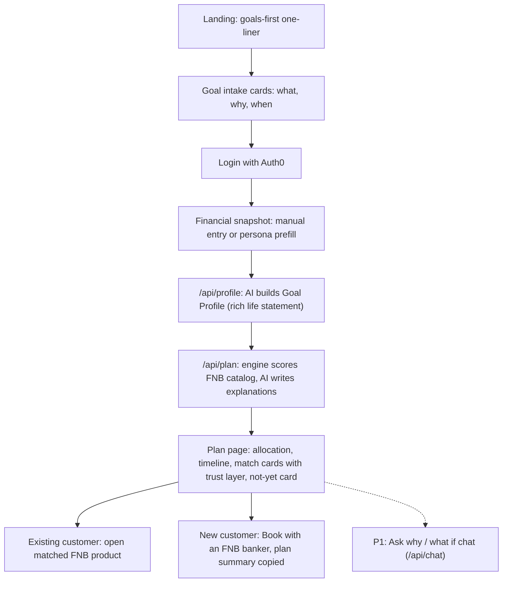

# User Flow

| Step | Route | Owner (issue) |
|---|---|---|
| Landing | `/` | Ethan (#8) |
| Intake | `/intake` | Ethan (#9) |
| Login | Auth0 | Ethan (#7) |
| Snapshot | `/snapshot` | Ethan (#10) |
| Goal Profile | `POST /api/profile` | Ben (#4) |
| Match + plan | `POST /api/plan` + engine | Ben (#3, #5) |
| Plan page | `/plan` | Ethan (#11) |
| Chat | `POST /api/chat` + panel | Ben (#6), Ethan (#12) |
